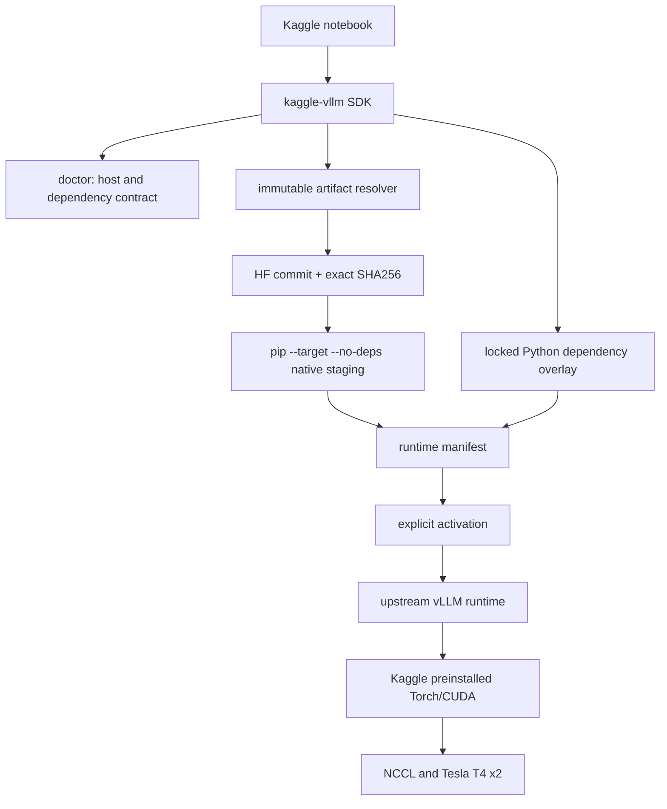

# SDK architecture

`kaggle_vllm` imports without torch or vLLM. The public API consists of `KaggleLLM`, `KaggleSamplingParams`, `bootstrap`, `activate_runtime`, and `load_profile`. `KaggleLLM` delegates execution to upstream vLLM and forwards advanced keyword options. Sampling parameters become upstream objects lazily. `chat()` renders a model chat template through Transformers, preferring `AutoProcessor` and falling back to `AutoTokenizer`.

The L4 profile pins hardware, ABI, native wheel SHA256, Torch/cu129, and TorchCodec. Offline bootstrap first discovers the four corrected split-v2 Kaggle Input Datasets, a pinned P31 native source, and the P33 168-wheel inference lock. The broader runtime-v3 archive is historical evidence. It verifies each wheel and stages the closure under `/tmp/kaggle-vllm/v0.3.0/l4x4/pydeps/` with `pip --target --no-deps --no-index --no-cache-dir --no-compile`. `activate_runtime()` prepends this target to Python's import path; `kaggle-vllm env` emits shell exports. A fresh Python process is recommended after activation if torch was imported earlier.

The CUDA driver helper creates only an SDK-owned `libcuda.so` symlink pointing at the live `/usr/local/nvidia/lib64/libcuda.so.1`. It adds the alias to `LIBRARY_PATH` and the real driver directory to `LD_LIBRARY_PATH`. It never changes `/usr/local/nvidia`.

P31 validated a global environment, so isolated staging remains a candidate until a clean Kaggle session runs the acceptance procedure. Source/build materials stay outside the user runtime artifact.

---

## Preserved historical v0.2 documentation

The section below is retained verbatim from the v0.2 repository state for historical users. Commands and defaults above describe the v0.3 candidate.

# Architecture and design rationale

Kaggle controls Python, PyTorch, the CUDA-facing runtime, driver mounts, base
Python packages and an ephemeral notebook filesystem. Native vLLM wheels are
tightly coupled to those layers. A normal `pip install vllm` may resolve a
different Torch/CUDA dependency set and disturb a working managed image.

`kaggle-vllm` therefore treats delivery as an explicit compatibility operation:

## Boundary of responsibility

The SDK owns profile validation, immutable resolution, streaming checksum
verification, safe cache/destination handling, staging plans, manifest-owned
reset, activation and thin convenience wrappers. It does not own or implement
vLLM kernels, model execution, scheduling, tensor parallelism, sharded-state
persistence or the OpenAI-compatible API.

## Why each constraint exists

- Immutable Hugging Face revision plus SHA256 prevents mutable-ref drift and
  detects byte changes.
- `--target --no-deps` keeps the native wheel out of system site-packages and
  prevents pip from replacing Kaggle Torch.
- A separate locked overlay fills known base-image gaps without declaring
  Torch, CUDA or vLLM as SDK dependencies.
- Explicit activation confines `PYTHONPATH`, `PATH` and `LD_LIBRARY_PATH`
  changes to the selected process or shell.
- A manifest records artifact identity, resolved paths and environment. Reset
  is allowed only for defaults or custom resources proven by that manifest.
- Large CUDA/model artifacts stay on Hugging Face rather than PyPI or Git.

The one lightweight runtime dependency, `packaging`, is used only for correct
PEP 440 dependency checks. Installing the SDK still does not pull vLLM, Torch
or CUDA packages.

## Extension points

Profiles are packaged under `src/kaggle_vllm/profiles/<profile>/`. Each profile
contains its native identity, overlay requirements/lock and dependency
baseline. This structure permits future profiles without weakening the only
current strong claim: Kaggle T4x2, cp312, cu128. New hardware profiles require
their own real acceptance evidence.
